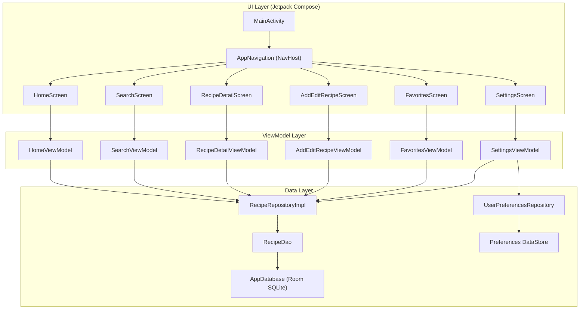

# 🍳 RecipeApp - Digital Culinary Library & Recipe Manager

> **Course:** Mobile Computing (Phase 1 Project)  
> **Institution:** Ain Shams University – Faculty of Computer and Information Sciences  
> **Platform:** Android (Min SDK 24, Target SDK 34)  
> **Language:** Kotlin 1.9+ | **UI Toolkit:** Jetpack Compose + Material 3  

---

## 📖 Project Overview

**RecipeApp** is an Android application designed for food enthusiasts, home cooks, and students. It acts as an interactive digital culinary library offering a curated collection of local Egyptian culinary staples (such as Koshari, Ful Medames, Molokhia, Hawawshi, Mahshi, Umm Ali, and Ta'ameya) alongside international recipes (Italian Carbonara, Neapolitan Pizza, Chicken Biryani, Greek Salad, and more).

Users can browse categories, perform real-time search across titles and ingredients, bookmark favorites, inspect detailed step-by-step cooking instructions, share recipes via Android Implicit Intents, open external culinary sources, and perform full CRUD (Create, Read, Update, Delete) management for their own customized recipes stored locally.

---

## 🌟 Key Features

1. **Rich Recipe Catalog & Categories:**
   - Filter recipes dynamically by categories: *All, Egyptian, Breakfast, Lunch, Dinner, Dessert, Vegetarian, Drinks*.
   - Responsive layouts optimized for both portrait phones and landscape/tablet devices.

2. **Full CRUD Operations (Room SQLite Persistence):**
   - **Create:** Add new personal recipes with photo selection from device gallery.
   - **Read:** Reactive Flow-driven listing and detail views with instant UI updates.
   - **Update:** Edit existing recipes with input validation.
   - **Delete:** Delete recipes with a Material 3 confirmation dialog.
   - **Pre-populated Database:** Automatically loads **22 authentic sample recipes** on initial launch.

3. **Smart Search & Favorites:**
   - Real-time search by recipe title, ingredients, or description.
   - One-tap bookmarking to a dedicated **Favorites** tab.

4. **Android Implicit Intents:**
   - **Share Recipe:** Send formatted recipe ingredients, prep time, and instructions to WhatsApp, Telegram, Gmail, or Notes using `Intent.ACTION_SEND` and `Intent.createChooser`.
   - **Open Web Reference:** Open external recipe guides or tutorial videos via `Intent.ACTION_VIEW`.
   - **Gallery Image Picker:** Select food photos from device storage via `ActivityResultContracts.GetContent()`.

5. **Theme Customization via Preferences DataStore:**
   - Switch between **System Default**, **Light Mode**, and **Dark Mode** on the fly with persistent preference storage.

---

## 🏛 Architecture & Tech Stack

The application follows the recommended Android **MVVM (Model-View-ViewModel)** and **Unidirectional Data Flow (UDF)** clean architecture principles.



### Technology Highlights
- **Jetpack Compose & Material 3:** Declarative UI with dynamic theming and color palettes.
- **Room Database 2.6.1:** Robust local SQLite persistence with reactive Kotlin `Flow`.
- **Navigation Compose 2.7.7:** Type-safe screen navigation with back-stack restoration.
- **Preferences DataStore 1.1.0:** Asynchronous, transactional key-value persistence for theme settings.
- **Kotlin Coroutines & StateFlow:** Structured concurrency and reactive state holders.

---

## 📱 Screenshots & UI Tour

| Home Screen & Categories | Search & Filters | Recipe Detail & Steps |
| :---: | :---: | :---: |
| *(Browse 22+ recipes with Category chips)* | *(Real-time search across ingredients)* | *(Prep time, ingredients & instructions)* |

| Add / Edit Recipe Form | Favorites Collection | Settings & Theme Toggle |
| :---: | :---: | :---: |
| *(Validated inputs & photo selector)* | *(Quick-access bookmarked recipes)* | *(Light / Dark mode & SQLite stats)* |

---

## 🚀 How to Run the Project

### Prerequisites
- **Android Studio:** Hedgehog (2023.1.1) or newer (Jellyfish / Koala recommended).
- **Android SDK:** Compile SDK 34, Minimum SDK 24.
- **JDK:** Java 17 or Java 11.

### Steps
1. Clone the repository:
   ```bash
   git clone https://github.com/<your-username>/RecipeApp.git
   cd RecipeApp
   ```
2. Open the project folder in **Android Studio**.
3. Allow Gradle to sync dependencies automatically.
4. Select an Android Emulator (API 26+) or a physical device with USB debugging enabled.
5. Click the green **Run (`Shift + F10`)** button.

---

## 📂 Project Directory Structure

```text
RecipeApp/
├── app/
│   ├── src/main/
│   │   ├── AndroidManifest.xml
│   │   ├── java/com/example/recipeapp/
│   │   │   ├── RecipeApplication.kt
│   │   │   ├── MainActivity.kt
│   │   │   ├── data/
│   │   │   │   ├── local/
│   │   │   │   │   ├── entity/ (RecipeEntity, RecipeCategory)
│   │   │   │   │   ├── dao/ (RecipeDao)
│   │   │   │   │   └── database/ (AppDatabase, SampleData)
│   │   │   │   ├── datastore/ (UserPreferencesRepository, AppThemeMode)
│   │   │   │   └── repository/ (RecipeRepository, RecipeRepositoryImpl)
│   │   │   └── ui/
│   │   │       ├── ViewModelFactory.kt
│   │   │       ├── theme/ (Color, Type, Theme, Shape)
│   │   │       ├── navigation/ (Screen, AppNavigation)
│   │   │       ├── components/ (RecipeCard, CategoryChipRow, EmptyStateView, ConfirmDeleteDialog)
│   │   │       └── screens/
│   │   │           ├── home/ (HomeScreen, HomeViewModel)
│   │   │           ├── search/ (SearchScreen, SearchViewModel)
│   │   │           ├── detail/ (RecipeDetailScreen, RecipeDetailViewModel)
│   │   │           ├── addedit/ (AddEditRecipeScreen, AddEditRecipeViewModel)
│   │   │           ├── favorites/ (FavoritesScreen, FavoritesViewModel)
│   │   │           └── settings/ (SettingsScreen, SettingsViewModel)
│   │   └── res/ (values, strings, colors, themes)
│   └── build.gradle.kts
├── docs/
│   ├── abstract.tex (ACM 2-page publication abstract)
│   └── presentation_guide.md (Complete oral defense guide & 35+ Q&A)
└── README.md
```

---

## 👥 Team Members

| Name | Student ID | Academic Email | Contribution Area |
| :--- | :---: | :---: | :--- |
| **Ahmed Amr Elsayed** (أحمد عمرو السيد) | 2022170545 | 2022170545@cis.asu.edu.eg | Project Architecture, Implicit Intents & DetailScreen |
| **Mohamed Diaa Eldin Saad** (محمد ضياء الدين سعد) | 2022170747 | 2022170747@cis.asu.edu.eg | Room Database, Entities, DAO & Repository |
| **Omar Ahmed Mohamed Ali** (عمر أحمد محمد علي) | 2022170267 | 2022170267@cis.asu.edu.eg | Jetpack Compose Theme & Reusable UI Components |
| **Ahmed Mohamed Ramadan** (أحمد محمد رمضان) | 2023170055 | 2023170055@cis.asu.edu.eg | Navigation Compose, HomeScreen & SearchScreen |
| **Ali Mohamed Ali Ahmed** (علي محمد علي أحمد) | 2022170260 | 2022170260@cis.asu.edu.eg | FavoritesScreen, SettingsScreen & DataStore Persistence |
| **Ahmed Ibrahim Elsayed** (أحمد إبراهيم السيد) | 2022170009 | 2022170009@cis.asu.edu.eg | Academic Documentation, ACM Research Paper & Defense Guide |

---

## 📄 License
This project is developed as part of the academic curriculum for the **Mobile Computing** course at **Ain Shams University**.
